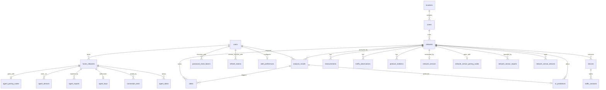

# Esquema de WiFiSense

## Tablas

| Tabla | Contenido | Claves y restricciones principales |
|---|---|---|
| `users` | Cuentas y rol | `username`, `email` únicos sin importar mayúsculas y correo guardado en minúsculas (V28) · `role` ∈ ADMIN/ANALYST/VIEWER/USER · `password_hash` BCrypt · `phone` opcional en formato internacional (V20) · `password_changed_at`: las sesiones emitidas antes dejan de valer (V20) |
| `locations` | Sedes | `name` único · nombre, dirección y ciudad no vacíos (V29) |
| `zones` | Áreas de una sede | FK `location_id` (CASCADE) · único (`location_id`, `name`) · nombre no vacío, piso entre -10 y 200 (V29) |
| `networks` | Redes Wi-Fi del equipo | FK `zone_id` (RESTRICT) · `bssid` único con formato MAC · banda, canal, seguridad, estado y fuente con CHECK · la fuente por defecto es `AGENT`, su sensor (V34) |
| `devices` | Clientes y AP | FK `network_id` (CASCADE) · `mac_address` único con formato MAC · señal entre -100 y 0 dBm |
| `measurements` | Rendimiento por lectura | FK `network_id` · latencia/jitter ≥ 0 · pérdida 0–100 · `bandwidth`, `signal`, `connected_devices` opcionales porque no toda fuente los mide · `source` es una fuente conocida (V34): `AGENT` si la tomó el sensor, `SIMULATION` si es simulada |
| `traffic_observations` | Volumen y paquetes por lectura | FK `network_id` · valores ≥ 0 · `observed_at` coincide con `measured_at` de la medición |
| `traffic_sessions` | Sesiones por dispositivo | FK `device_id` · puerto 0–65535 · `ended_at ≥ started_at` |
| `protocol_statistics` | Paquetes por protocolo y periodo | único (`network_id`, `protocol`, `period_start`) · `period_end ≥ period_start` |
| `analysis_results` | Resultado de cada análisis | FK `network_id`, FK `requested_by` (SET NULL; NULL = monitoreo automático) · `score` 0–1 |
| `ai_predictions` | Respuesta del modelo | FK único `analysis_result_id` (1:1) · `anomaly_score` 0–1 · `simulated_data` obligatorio · `anomaly_type` (V15): causa probable; NULL en predicciones anteriores, `NONE` solo si no hay anomalía |
| `alerts` | Alertas por cambio de estado | `status` ∈ OPEN/ACKNOWLEDGED/RESOLVED · CHECK: `resolved_at` existe si y solo si está RESOLVED |
| `home_networks` | Redes que registra cada usuario final | FK `owner_id` → `users` (CASCADE) · nombre único por dueño sin importar mayúsculas · `contracted_mbps` 1–10 000 |
| `connection_tests` | Pruebas de conexión desde Mi Wi-Fi | FK `home_network_id` (CASCADE) · latencia > 0 · velocidades 0–10 000 Mbps · `quality_score` 0–100 y `quality_grade` van juntos o ambos NULL (IA no disponible) · `quality_details` JSONB con el detalle que mostró la página |
| `agent_keys` | Clave del agente WiFiSense de cada red | FK `home_network_id` (CASCADE) única: una clave por red · `key_hash` SHA-256 en hexadecimal (la clave nunca se guarda) · `key_prefix` visible para reconocerla · `last_seen_at` último reporte |
| `agent_reports` | Reportes del agente con el veredicto de la IA | FK `home_network_id` (CASCADE) · seguridad del Wi-Fi ∈ OPEN/WEP/WPA/WPA2/WPA3/UNKNOWN · señal −100–0 dBm · `new_device_count` ≤ `device_count` · `security_score`/`security_grade` juntos o NULL · causa de anomalía como en V15 · `details` JSONB (puertos, hallazgos, calidad y canal recomendado) |
| `password_reset_tokens` | Enlaces para restablecer la contraseña (V21) | FK `user_id` (CASCADE) · `token_hash` SHA-256 único (el enlace nunca se guarda) · `expires_at` > `created_at` · `used_at`: un enlace sirve una sola vez |
| `refresh_tokens` | Sesiones que se renuevan solas (V30) | FK `user_id` (CASCADE) · `token_hash` SHA-256 único · `family_id`: todos los tokens de un mismo inicio de sesión · `used_at` (rotación) y `revoked_at` · `expires_at` > `created_at` |
| `network_sensors` | Sensor de cada red del equipo (V35): el agente WiFiSense instalado en esa red | FK `network_id` (CASCADE), uno por red · `key_hash` SHA-256 único · `key_prefix` con formato `wsa_…` · `last_seen_at`, `agent_version` y `platform` del último reporte |
| `network_sensor_pairing_codes` | Código de 8 caracteres para instalar el sensor (V35) | FK `network_id` (CASCADE), uno vigente por red · `code_hash` SHA-256 único · vence como máximo una hora después |
| `network_sensor_reports` | Reportes del sensor de cada red del equipo con el veredicto de la IA (V36) | FK `network_id` (CASCADE) · mismas reglas que `agent_reports`: seguridad del Wi-Fi conocida, señal −100–0 dBm, `new_device_count` ≤ `device_count`, puntaje y grado de seguridad juntos · `details` JSONB objeto (puertos, hallazgos, calidad y mejor canal) |
| `network_sensor_devices` | Equipos que ve el sensor en cada red del equipo (V36) | PK (`network_id`, `fingerprint`) · huella SHA-256 de 24 hex, nunca la MAC · `label`, `vendor`, `hostname` no vacíos · `authorized` FALSE = un administrador lo marcó como no autorizado · `private_mac` · `first_seen_at` ≤ `last_seen_at` |
| `agent_pairing_codes` | Código corto para instalar el agente (V22) | FK `home_network_id` (CASCADE) única: un código pendiente por red · `code_hash` SHA-256 · vence como máximo en 1 hora |
| `alert_preferences` | Qué avisos por correo quiere cada usuario (V24) | PK/FK `user_id` (CASCADE) · tres interruptores, todos encendidos por defecto |
| `agent_alerts` | Historial de avisos de cada red y antirrepetición del correo (V24) | FK `home_network_id` (CASCADE) · `type` ∈ NEW_DEVICE/UNAUTHORIZED_DEVICE/SECURITY/ANOMALY · `emailed` si ya se envió |
| `agent_devices` | Equipos vistos en cada red | PK (`home_network_id`, `fingerprint`) · `fingerprint` huella SHA-256 de 24 hex: nunca la MAC · `label` nombre que le pone el usuario · `vendor` fabricante y `hostname` nombre en la red según el OUI (V23) · `authorized` FALSE = marcado como no autorizado (V23) · `private_mac` usa una MAC aleatoria, casi siempre un celular o tableta (V25) · `first_seen_at` ≤ `last_seen_at` |

## Decisiones

- **`ON DELETE`**: borrar una red borra su historial (CASCADE); borrar una zona con redes está prohibido
  (RESTRICT) para no perder datos por accidente; borrar un usuario conserva sus análisis (SET NULL).
- **Enums como `VARCHAR` + `CHECK`** en vez de tipos `ENUM` de PostgreSQL: agregar un valor es un `ALTER ... CHECK`
  sencillo y JPA los mapea sin configuración extra.
- **`TIMESTAMPTZ`** en todas las fechas; el backend trabaja en UTC.
- **`DOUBLE PRECISION`** para métricas: son mediciones físicas, no montos.
- **Privacidad del agente**: la clave se guarda como SHA-256 (como una contraseña de alta entropía) y los equipos
  como huellas con sal; el `CHECK` de formato impide guardar por error una MAC o una clave en claro.
- **Usuarios y correos sin importar mayúsculas (V28)**: la unicidad usa `lower(...)` y un disparador guarda cada
  correo en minúsculas, así ninguna aplicación (ni una versión anterior del backend) puede crear `Ana` y `ana`.
- **Reglas también en la base (V29)**: lo que valida el backend (nombres no vacíos, JSON como objeto) también lo
  impone la base, para que un `INSERT` desde DBeaver o un script no rompa la aplicación.
- **Refresh tokens con rotación (V30)**: cada token sirve una vez y se cambia por otro de la misma familia; si uno ya
  usado vuelve a aparecer, alguien lo copió y se revoca la familia entera.
- **Mínimos privilegios**: el backend usa `wifisense_app`, que no puede cambiar el esquema (ver `seguridad.md`).
- **Diccionario en la base (V31–V33)**: cada tabla y columna tiene `COMMENT ON`; DBeaver lo muestra.
- **Sensor para las redes del equipo (V34–V35)**: el backend vive en Railway y no ve la red del equipo, así que la
  mide el mismo agente de Mi Wi-Fi instalado en un computador de esa red. Tablas propias en vez de reutilizar
  `agent_keys`: una clave de agente pertenece a la red de un usuario y una clave de sensor a una red del equipo, y
  así ninguna consulta de un lado puede tocar los datos del otro.

## Índices

| Índice | Consulta que acelera |
|---|---|
| `idx_measurements_network_time (network_id, measured_at DESC)` | Ventana de análisis e historial por red |
| `idx_traffic_observations_network_time` | Cruce de tráfico con mediciones |
| `idx_analysis_results_network_time` | Historial de análisis por red |
| `idx_ai_predictions_anomalies` (parcial, `WHERE anomaly_detected`) | Lista de anomalías y conteo de 24 h |
| `idx_alerts_open (status, created_at DESC)` | Alertas por estado y conteo de pendientes |
| `idx_*_network`, `idx_zones_location` | Joins por clave foránea |
| `idx_ai_predictions_anomaly_type` (V15, parcial) | Anomalías agrupadas por causa en un periodo |
| `idx_connection_tests_network_time` (V16) | Historial de pruebas de una red, de la más reciente a la más antigua |
| `idx_agent_reports_network_time` (V18) | Últimos reportes del agente y ventana que analiza la IA |
| `idx_agent_reports_received`, `idx_agent_devices_last_seen` (V18, V19) | Borrado diario de reportes y equipos de más de 30 días |
| `idx_agent_devices_unauthorized` (V23) | Equipos no autorizados aún conectados, primero en Mi Wi-Fi |
| `idx_agent_alerts_network_time` (V24) | Últimos avisos de una red y comprobar si un aviso ya se envió hace poco |
| `idx_agent_reports_anomalies` (V25) | Parcial (`WHERE anomaly_detected`): redes con anomalías en las últimas 24 h, para el panel del equipo |
| `uq_users_email_lower`, `uq_users_username_lower` (V28, únicos) | Buscar la cuenta por correo o usuario sin importar mayúsculas, e impedir duplicados como `Ana`/`ana` (reemplazan a `idx_users_email_lower` de V20) |
| `idx_password_reset_tokens_user`, `idx_password_reset_tokens_expiry` (V21) | Invalidar enlaces anteriores y borrar los vencidos |
| `idx_analysis_results_requested_by`, `idx_ai_predictions_network`, `idx_alerts_analysis_result` (V26) | Las tres claves foráneas que no tenían índice: borrar una cuenta, una red o un análisis sin recorrer tablas completas |
| `idx_measurements_measured_at`, `idx_traffic_observations_observed_at`, `idx_traffic_sessions_started_at`, `idx_protocol_statistics_period_start`, `idx_analysis_results_created_at`, `idx_agent_alerts_created_at`, `idx_agent_pairing_codes_expires_at` (V27) | Limpieza nocturna por fecha de todas las redes a la vez (los índices por red no sirven para "todo lo anterior a esta fecha") |
| `idx_alerts_resolved_at` (V27, parcial `WHERE status = 'RESOLVED'`) | Borrar solo alertas resueltas antiguas; las abiertas nunca se borran |
| `idx_refresh_tokens_user`, `idx_refresh_tokens_family`, `idx_refresh_tokens_expires_at` (V30) | Cerrar todas las sesiones de una cuenta, revocar una familia robada y borrar las vencidas |
| `idx_network_sensor_pairing_codes_expires_at` (V35) | Borrar cada hora los códigos vencidos del sensor; las búsquedas por red y por hash usan sus restricciones únicas |
| `idx_network_sensor_reports_network_time`, `idx_network_sensor_reports_received`, `idx_network_sensor_devices_last_seen` (V36) | Últimos reportes del sensor de una red para el panel, y limpieza nocturna por fecha de reportes y equipos |

`tests/optimizacion_test.sql` comprueba con `EXPLAIN` que cada consulta de esta tabla puede usar su índice y que no
queda ninguna clave foránea sin índice.
